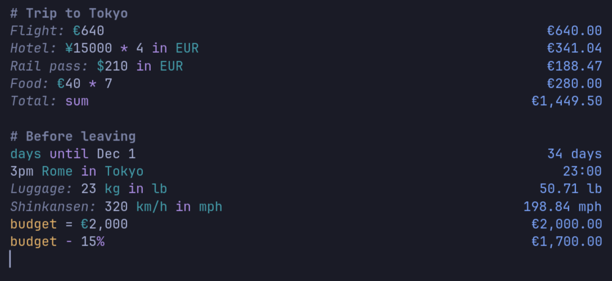

# Napkin

A calculator you write in plain words, for Linux. Each line is a calculation;
the result appears beside it as you type. Built with Rust, GTK4 and
libadwaita, and at home on Omarchy: it takes the colours of the active theme,
the terminal's font and Hyprland's corners, and follows them when they change.



## Examples

Each table shows what you write and what Napkin shows. Dates assume Wednesday
14 October 2026, 12:00 in Rome. Money uses sample rates (1 USD = 0.90 EUR =
0.75 GBP = 150 JPY = 1.40 CAD, 1 BTC = 100,000 USD); with live rates the
results differ.

### Numbers and operators

| You write | Napkin shows |
| --- | --- |
| `7 times 6` | 42 |
| `10 divide by 4` | 2.5 |
| `0.1 + 0.2` | 0.3 |
| `2^64` | 18,446,744,073,709,551,616 |
| `2k + 5 million` | 5,002,000 |
| `(1 + 2)(3 + 4)` | 21 |
| `255 in hex` | 0xff |
| `0xFF + 0b101` | 0x104 |
| `4 700 in sci` | 4.7e3 |

### Percentages

| You write | Napkin shows |
| --- | --- |
| `15% of $40` | $6.00 |
| `10% on $35` | $38.50 |
| `25% off 60 EUR` | €45.00 |
| `$80 - 15%` | $68.00 |
| `$45 as a % of $180` | 25% |
| `4% of what is 9 EUR` | €225.00 |

### Units

| You write | Napkin shows |
| --- | --- |
| `12 inches in cm` | 30.48 cm |
| `2 m + 35 cm` | 235 cm |
| `5 feet 11 inches in cm` | 180.34 cm |
| `100 °F in °C` | 37.78 °C |
| `1 GiB in MB` | 1,073.74 MB |
| `30 sq cm in m2` | 0.003 m² |
| `1 cup in ml` | 236.59 mL |
| `9 pt in px` | 12 px |

In a sum of different units the result takes the last one: `2 m + 35 cm` is
235 cm, `35 cm + 2 m` is 2.35 m.

### Speed, energy, power and pressure

Beyond Numi. Rates are written without spaces (`km/h`, `MB/s`, `L/100km`) and
also come out of a calculation.

| You write | Napkin shows |
| --- | --- |
| `120 km/h in mph` | 74.56 mph |
| `100 km / 2 h` | 50 km/h |
| `50 km/h * 3 h` | 150 km |
| `2 kW * 3 h` | 6 kWh |
| `3.5 kWh * €0.25` | €0.88 |
| `100 kcal in kJ` | 418.4 kJ |
| `150 CV in kW` | 110.32 kW |
| `2 bar in psi` | 29.01 psi |
| `6 L/100km in mpg` | 39.2 mpg |
| `15 km/L in L/100km` | 6.67 L/100km |
| `100 Mbps in MB/s` | 12.5 MB/s |

### Money

| You write | Napkin shows |
| --- | --- |
| `100 USD in EUR` | €90.00 |
| `$70 CAD + 10 USD - 4EUR` | €50.00 |
| `¥1000 in USD` | $6.67 |
| `1 BTC in EUR` | €90,000.00 |

Add `on` and a date to use the rates of that day: `100 USD in EUR on Jan 15`
shows €86.03, with the ECB rate of 15 January 2026. Napkin downloads the rates
of a day the first time a line asks for them and keeps them; they cover about
30 currencies and no cryptocurrencies.

### Dates

| You write | Napkin shows |
| --- | --- |
| `today + 4 weeks` | 2026-11-11 |
| `2026-01-31 + 1 month` | 2026-02-28 |
| `days until Dec 25` | 72 days |
| `25 december to today in days` | 72 days |
| `days since 1 jan` | 286 days |
| `between Jan 1 and Mar 1` | 59 days |
| `now + 90 min` | 2026-10-14 13:30 |
| `fromunix(1700000000)` | 2023-11-14 23:13:20 |

### Time zones

| You write | Napkin shows |
| --- | --- |
| `time in Tokyo` | 19:00 |
| `Chicago time` | 05:00 |
| `3pm London in Rome` | 16:00 |
| `4:15 pm JST in Paris` | 09:15 |
| `3pm London - 3pm Tokyo` | 8 h |
| `from 9am to 5pm` | 8 h |

Cities, IANA names (`Europe/Rome`), abbreviations (`PST`) and offsets
(`UTC+5:30`) all work.

### Functions

| You write | Napkin shows |
| --- | --- |
| `sqrt 49 + 3` | 10 |
| `root 3 (20)` | 2.71 |
| `log 3 (50)` | 3.56 |
| `sin 60°` | 0.87 |
| `arcsin 1 in degrees` | 90° |
| `round(3.456; 2)` | 3.46 |
| `5!` | 120 |

### Variables, `prev` and sums

A variable is set with `=` and holds from its line down; `prev` is the result
of the line above.

```
rent = €850                     €850.00
bills = $120 in EUR             €108.00
rent + bills                    €958.00
prev - 5%                       €910.10
```

`sum` and `avg` add up the lines above, up to the first empty line or header.

```
Taxi: $18                        $18.00
Dinner: $42                      $42.00
Total: sum                       $60.00
Average: avg                     $30.00
```

### Labels, headers and comments

Text before a colon is a label, a line starting with `#` is a header, and
`//` or text in double quotes is a comment. A label is not a variable: to reuse
a value, set it with `=`.

```
# Trip to Tokyo
Flight: €640                    €640.00
Hotel: ¥15000 * 4 in EUR        €360.00
// notes are ignored
$48 for the "garden hose"       $48.00
```

### Preferences

With the decimal comma, `1.234,5 + 1` shows 1.235,5. With the 12-hour clock,
`3pm` shows 3:00 PM.

## Build and run

```sh
cargo run -p napkin                 # open the window
cargo run -p napkin -- --toggle     # show it, or hide it when it has the focus
cargo test                          # unit tests and the golden files
```

Install for the current user (binary in `~/.local/bin`, launcher entry, icon):

```sh
packaging/install.sh
```

Or build an Arch package from this checkout: `cd packaging && makepkg -si`.

## Omarchy setup

Napkin sits beside Omacalc, Omarchy's keypad calculator, rather than in its
place. Give it a key of its own in `~/.config/hypr/bindings.lua`:

```lua
o.bind("SUPER + ALT + Q", "Napkin", o.launch("napkin --toggle"))
```

and make its window float, at the end of `~/.config/hypr/hyprland.lua`:

```lua
o.window("napkin", { tag = "+floating-window" })
o.window("napkin", { workspace = "special:napkin" })
```

The second line gives Napkin a scratchpad of its own: the shortcut shows and
hides it over any workspace, like a drop-down terminal. Without it Napkin also
lives in Omarchy's own scratchpad: `SUPER + ALT + S` moves it there and
`SUPER + S` shows it. In a scratchpad, `Esc` and `napkin --toggle` show and hide
the scratchpad, so the window stays in it; elsewhere they show and hide the
window. With *Start at login* on, Napkin starts hidden and the shortcut shows
it.

To open Napkin with the Calculator key, or with Omacalc's shortcut, unbind the
key first. Omacalc's shortcut depends on the Omarchy release
(`SUPER + CTRL + Q` in 4.0, `SUPER + SHIFT + Q` in later builds); the
keybindings menu, `SUPER + K`, shows the one you have:

```lua
hl.unbind("XF86Calculator")
o.bind("XF86Calculator", "Calculator", o.launch("napkin --toggle"))
```

Napkin reads the palette of the active theme from
`~/.local/state/omarchy/current/theme/colors.toml` and watches that folder:
switching theme recolours it at once, light themes included. Outside Omarchy it
follows the system light or dark style. The sheet is written in fontconfig's
monospace font, the one `omarchy font set` gives the terminal, and changes with
it. Menus and dialogs take Hyprland's corner radius, square on Omarchy.

Napkin speaks the language picked under Setup > Language, any of Omarchy's 50,
and switches as soon as it changes; outside Omarchy it takes the system's.
Menus, dialogs and the reasons a line has no result are translated, while what
you write stays English (`in`, `of`, `today`, the units and the functions), the
same in every language. In Arabic, Hebrew, Persian and Urdu the menus and
dialogs read right to left and the sheet keeps its results on the right. On a
first start the number format follows the language too, with the decimal comma
for Italian, German, French and the others that write one. GTK's own words,
such as Cut and Paste, keep the language Napkin started in.

## From the terminal

```sh
napkin eval "100 USD in EUR"        # one line
printf 'v = 5\nv * 3\n' | napkin eval   # a sheet, one result per line
napkin test FILE.golden             # golden test files
```

`eval` uses the cached exchange rates and never touches the network.

## Keyboard

| Action | Keys |
| --- | --- |
| Copy the result of the current line | Ctrl+Shift+C |
| Copy the result, when nothing is selected | Ctrl+C, or Super+C on Omarchy |
| Copy every line with its result | Ctrl+Alt+C |
| Wrap the selection in parentheses | Ctrl+Shift+0 |
| Clear the sheet | Ctrl+Alt+Backspace |
| Bigger or smaller text | Ctrl+plus, Ctrl+minus |
| Preferences | Ctrl+comma |
| Menu | F10, or right click |
| Keyboard shortcuts | F1 |
| Hide the window | Esc |
| Quit | Ctrl+Q |

Napkin has no title bar: the menu (copy all results, preferences, keyboard
shortcuts, about) is in the right-click menu of the sheet, and F10 opens it
from the keyboard. A click on a result copies it; a click on the total copies
the total.

## Files

| Path | Holds |
| --- | --- |
| `~/.local/share/napkin/sheet.txt` | The sheet, saved a second after each change |
| `~/.config/napkin/settings.toml` | Preferences |
| `~/.config/omarchy/language` | Omarchy's language, read and watched, never written |
| `~/.cache/napkin/rates.json` | Exchange rates, read before any download |
| `~/.cache/napkin/history.json` | Rates of past days, for lines with `on <date>` |

## Layout

| Crate | Role |
| --- | --- |
| `crates/engine` | The calculation engine: sheet text and a context in, results out. No network, no clock. |
| `crates/rates` | Downloads exchange rates and keeps the cache |
| `crates/app` | The GTK window and the `napkin` command |

The translations are in `crates/app/i18n`: `strings.txt` lists the English, and
each `<code>.json` maps it to one language, by Omarchy's codes.

## Data

- Exchange rates by [Exchange Rate API](https://www.exchangerate-api.com), with
  ECB rates via [Frankfurter](https://frankfurter.dev) as a fallback.
- Cryptocurrency prices by [CoinGecko](https://www.coingecko.com).
- City time zones from [GeoNames](https://www.geonames.org), CC BY 4.0
  (`crates/engine/data/cities.tsv`, built by `tools/gen_cities.py`).

## License

MIT, see [LICENSE](LICENSE). The city data in `crates/engine/data/cities.tsv`
is derived from GeoNames and licensed
[CC BY 4.0](https://creativecommons.org/licenses/by/4.0/); [NOTICE](NOTICE)
says what was changed.

Napkin is inspired by [Numi](https://github.com/nikolaeu/numi), the
natural-language calculator for macOS. It is written from scratch and contains
no code or data from Numi.
